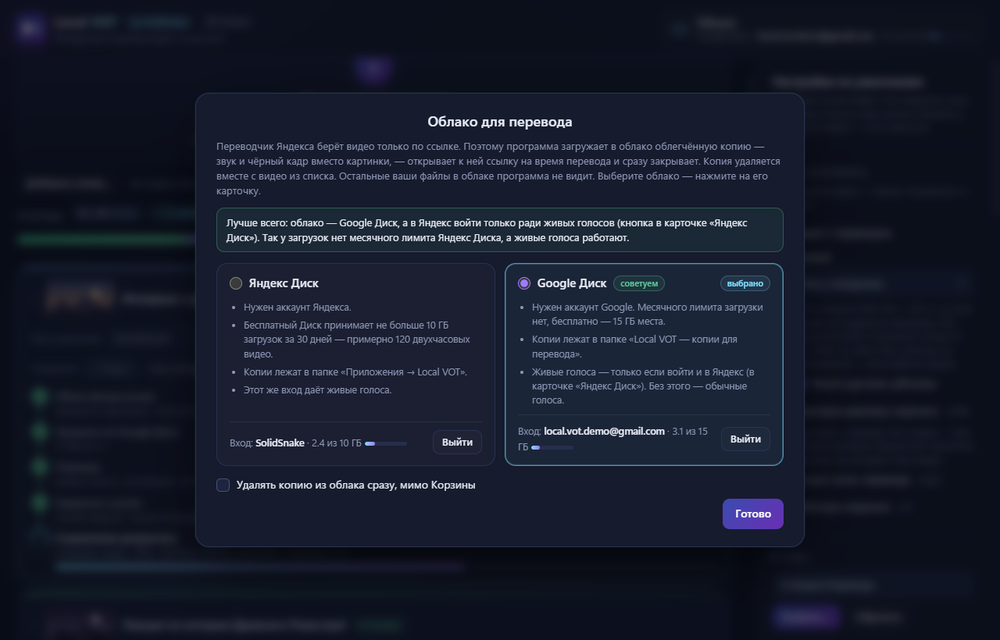

<p align="center">
  
</p>

<h1 align="center">Local VOT</h1>

<p align="center">
  <a href="README.en.md"></a>
  <a href="README.md"></a>
  
</p>

<p align="center">
  Russian voice-over for your own video files, made by Yandex's video translation — like in Yandex Browser,
  but for videos on your computer.
</p>

<p align="center">
  <a href="https://github.com/SolidSnake1765/local-vot/releases/latest"><b>⬇ Download for Windows</b></a>
</p>

<p align="center">
  
</p>

## What it is

Yandex has great video voice-over translation, but it only works in the browser and only for online videos.
**Local VOT** translates videos stored on your computer. The translation is always **into Russian**, and the app's interface is in Russian too.

It is built on two open-source libraries: [vot.js](https://github.com/FOSWLY/vot.js) talks to the Yandex
translator, [ffmpeg](https://ffmpeg.org) handles audio and video. The idea is to get translations through
**your own Yandex Disk or Google Drive**: the app uploads the video's audio there, shares it for the time of
translation and passes the link to the translator. No local servers, tunnels, network setup or other complicated schemes —
add a video, press "Start", get the translated video.

> [!IMPORTANT]
> You need a **Yandex account with Yandex Disk or a Google account with Google Drive** (the free space is enough).
> You sign in on the Yandex or Google website — the app never sees your password. It only has access to its own
> files and cannot see your other files. With Google Drive a Yandex account is optional: without it translation
> uses regular voices; for lively voices, sign in to Yandex once as well.

> [!TIP]
> **Best setup:** use **Google Drive** as the cloud and sign in to **Yandex** only for lively voices (both sign-ins
> are in the «Облако» (Cloud) window). This way there is no Yandex Disk monthly upload limit (10 GB per 30 days),
> and lively voices still work.

> [!TIP]
> Want translation right in the browser — for YouTube and other sites? Use the
> [voice-over-translation](https://github.com/ilyhalight/voice-over-translation) extension.
> Local VOT is for videos that are already on your computer.

## Features

- **Voice-over** — the original sound is lowered while the translation speaks and plays at full volume in pauses.
- **Lively voices** — translation voices that sound like the original speakers (English only; if the video speaks
  another language, the app translates it with regular voices and auto-detection by itself).
- **10 source languages** with auto-detection: English, German, French, Spanish, Italian, Japanese,
  Chinese, Korean, Arabic. The app warns you if the language is set wrong.
- **No censorship** — translates any video.
- **Queue** — add whole folders, reorder by drag-and-drop, press "Start all". Already translated videos are skipped.
  Video thumbnails like in Windows Explorer and a "Show in folder" button; progress counter and overall bar (stays
  visible while you scroll the list), "Cancel all", "Clear". Stays smooth even with a hundred videos.
  The list can be **kept between launches** — unfinished videos continue by themselves; the app can **shut down
  the PC when the queue is done**.
- **Several videos at once** — up to 8 translated by Yandex simultaneously; preparing light copies and assembling
  finished videos also run in parallel without waiting for each other, so new videos head to Yandex while others
  are being assembled. A "one at a time" mode is there for slow PCs and hard drives (HDD). Audio is encoded
  **on all CPU cores**: the track of a two-hour video takes tens of seconds, not minutes.
- **Windows notifications** — when a video or the whole queue is done (if the window is minimized); can be turned off.
- **16 formats**: MP4, MKV, MOV, AVI, WebM, M4V, WMV, FLV, TS, MPG, MPEG, M2TS, MTS, 3GP, VOB, OGV.
  The result is saved in the same format as the source, or always MP4 / always MKV — your choice; the picture is never re-encoded.
- **No quality loss** — the picture is copied as is, the audio is saved at no lower quality than the original.
- **Per-video sound settings** — original and translation volume with a preview right in the app;
  changed it — re-save in seconds, without translating again. The translation volume adapts to the original
  where the speech is, and loud videos don't distort.
- **What to save** — the translated video (with embedded subtitles), a separate `.m4a` audio track
  (for players with external tracks), the translation voice `.mp3`, subtitles `.srt`. Defaults are set in the
  settings and can be changed for any single video in its card.
- **Yandex Disk or Google Drive** — choose which one passes the video to the translator with the **«Облако»** (Cloud) button at the top of the window —
  it also describes both options and lets you sign in and out. Google Drive has no monthly upload limit like Yandex Disk.
- **Privacy** — only the audio goes to the cloud (the picture is replaced by a black frame), the link to the copy is
  open only during translation, and the copy is removed once the video leaves the list or the app is closed.
  The app's log contains no video names. See the [privacy policy](PRIVACY.md).

## Installation

Download from the [latest release](https://github.com/SolidSnake1765/local-vot/releases/latest):

| File | What it is |
|---|---|
| `Local-VOT-…-setup.exe` | **Installer** — shortcuts on the desktop and in Start, uninstalls via Settings → Apps together with all its data. |
| `Local-VOT-…-portable.zip` | **Portable** — unpack anywhere (even to a USB stick) and run `Local VOT.exe`. All settings and temporary files stay in its own `data` folder; nothing is left in the system. |

**Requirements:** Windows 10 or 11 (64-bit; works on Windows ARM through built-in emulation), internet,
a Yandex or Google account. A little Disk space is needed — up to ~1 MB per minute of video while the video is in the list
(if it runs out, the app removes the Disk copies of already finished videos).

> [!NOTE]
> The app is not signed with a paid certificate, so on first launch Windows may show
> "Windows protected your PC". Click **More info → Run anyway**.

## Updating

New versions appear on the [releases](https://github.com/SolidSnake1765/local-vot/releases) page.
To get notified: the **Watch** button at the top of the repository page → **Custom** → **Releases**.
Settings, the Yandex sign-in and the log are kept when updating.

- **Installer** — close the app, download the new `…-setup.exe` and run it: it installs over the old
  version, into the same folder.
- **Portable** — close the app and unpack the new archive **into the same place where the "Local VOT"
  folder is** (not inside it), replacing the files. The `data` folder with your settings is not replaced —
  it is not in the archive.

## How to use

1. Press the **«Облако»** (Cloud) button at the top and choose how to pass videos to the translator: Yandex Disk or
   Google Drive. Press **«Войти через Яндекс»** (Sign in with Yandex — open the Yandex page, enter the code from the
   app and allow access) or **«Войти через Google»** (Sign in with Google — the Google page opens in your browser).
   With Google Drive, also sign in to Yandex there for lively voices.

   <p align="center">
     
   </p>

2. Drag videos (or a whole folder) into the app window.
3. In the video card, check the **original language** (the language spoken in the video), the voices and what
   to save, reorder the queue and press **«Запустить все»** (Start all). Defaults live in the right-hand
   «Настройки по умолчанию» (Default settings) panel — including how many videos to translate at once («Очередь»).
4. When the translation is ready, listen to a fragment right in the video card and adjust the volume if you
   like — **«Сохранить с этим звуком»** (Save with this sound) rebuilds the file in seconds.

<p align="center">
  
</p>

Finished files are saved next to the source video (or in the chosen folder) with `[RU]` in the name.

## FAQ and limitations

- **The Yandex translator API is unofficial.** If Yandex changes something, translation may stop working
  until the app is updated.
- **Videos up to 4 hours** — a limit of the Yandex translator. Longer videos are marked with an error right away
  (nothing is uploaded); you can cut them into parts.
- **Yandex Disk monthly upload limit.** Within 30 days of the first upload you can upload at most twice your Disk
  size: 10 GB on the free 5 GB plan. The app compresses the audio it sends to Yandex, so the copy of a two-hour
  video is about 85 MB — roughly 120 such videos a month. Mail attachments and phone photo auto-upload count too.
  When the limit is reached, the app says so: wait until it resets (30 days after the first upload), sign in with
  another Yandex account or get more Disk space. The free plan also limits a single file to 1 GB; copies of videos
  up to 4 hours fit. Google Drive has no such limit.
- **Lively voices** are available for English only; if they fail, the app translates with regular voices.
- **To revoke the app's access** to your account, use [Yandex ID](https://id.yandex.ru) or your
  [Google account](https://myaccount.google.com/permissions) — in the list of apps you have allowed access.
  «Выйти» (Sign out) in the app revokes Google access by itself.
- **Found a bug?** Open an [issue](https://github.com/SolidSnake1765/local-vot/issues) and attach the log:
  the **«Папка логов»** (Logs folder) link at the bottom of the settings panel. The log contains no video names,
  paths or sign-in data — videos are referred to as "video #N".

## Building from source

You need [Node.js](https://nodejs.org) 24 and the keys of your own apps from [oauth.yandex.ru](https://oauth.yandex.ru)
(permissions: access to the app folder on Disk and to Disk information) and from
[console.cloud.google.com](https://console.cloud.google.com) (Google Drive API, "Desktop app" client, `drive.file` scope).

```bash
npm install
copy .env.example .env      # fill in the Yandex and Google keys
npm start                   # run from source
npm test                    # checks (tests/): ~30 s, no Yandex account or keys needed
npm run dist                # installer and portable version in the dist folder
```

## Built with

- [vot.js](https://github.com/FOSWLY/vot.js) — Yandex translator client (MIT).
- [ffmpeg](https://ffmpeg.org) 9.0.2 — audio and video. A slim custom build with only what the app needs; see
  [`scripts/build-ffmpeg.sh`](scripts/build-ffmpeg.sh). ffmpeg is distributed under the GPL v3; its license text and
  where the sources come from are in the app folder `resources\ffmpeg`.
- [Electron](https://www.electronjs.org) — app shell.

## License

[MIT](LICENSE) — use, modify and share freely, including in your own projects. The license requires one
thing: keep the author notice (© 2026 SolidSnake) and the license text.

If you fork this project or use its code and ideas, please link back to this repository:
**[github.com/SolidSnake1765/local-vot](https://github.com/SolidSnake1765/local-vot)**.

## 💜 Acknowledgements

- **The developers of [Yandex.Translate](https://translate.yandex.ru) and [Yandex.Browser](https://browser.yandex.ru)** —
  for the video voice-over translation that powers this whole app.
- **The authors of the [voice-over-translation](https://github.com/ilyhalight/voice-over-translation) extension** —
  for the idea: this app would not exist without their extension. Special thanks for the
  [vot.js](https://github.com/FOSWLY/vot.js) library that Local VOT uses to talk to the translator.

> All rights to the original software belong to their respective owners. The app is not affiliated with the
> original rights holders.
