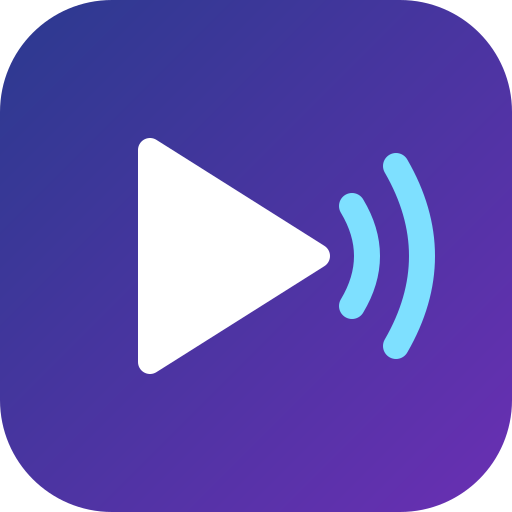
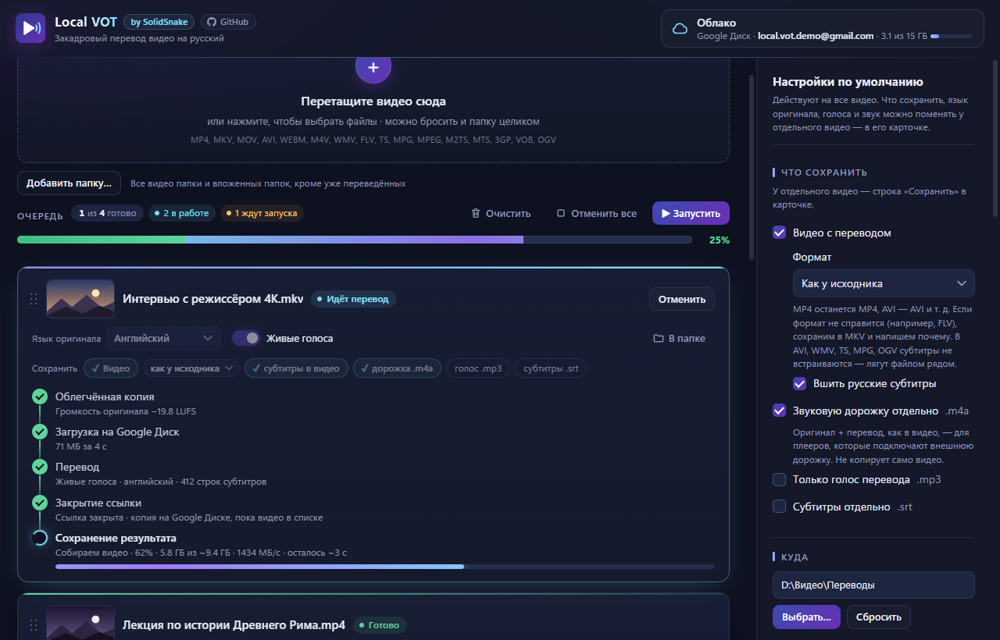
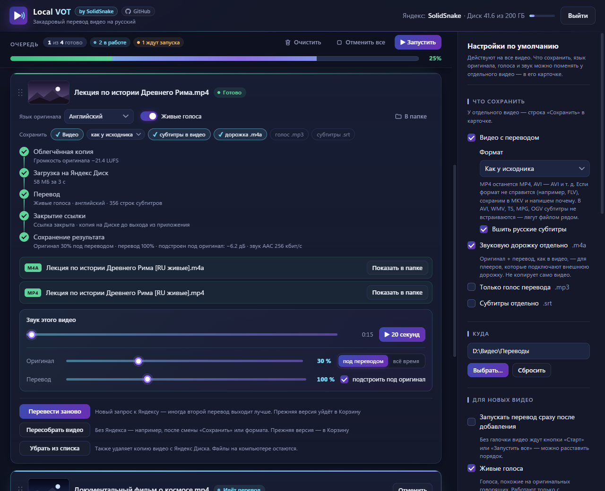

<p align="center">
  
</p>

<h1 align="center">Local VOT</h1>

<p align="center">
  <a href="README.en.md"></a>
  <a href="README.md"></a>
  
</p>

<p align="center">
  Закадровый перевод ваших видео на русский голосами Яндекса — как в Яндекс Браузере, но для файлов на компьютере.
</p>

<p align="center">
  <a href="https://github.com/SolidSnake1765/local-vot/releases/latest"><b>⬇ Скачать для Windows</b></a>
</p>

<p align="center">
  
</p>

## Что это и зачем

У Яндекса отличный закадровый перевод видео, но работает он только в браузере и только для роликов
в интернете. **Local VOT** переводит видео, которые лежат у вас на компьютере.

Основа — две открытые библиотеки: [vot.js](https://github.com/FOSWLY/vot.js) общается с переводчиком
Яндекса, [ffmpeg](https://ffmpeg.org) работает со звуком и видео. Идея программы — получать перевод через
**ваш Яндекс Диск или Google Диск**: программа загружает туда звук видео, открывает к нему ссылку на время
перевода и передаёт её переводчику. Никаких локальных серверов, туннелей, настроек сети и прочих сложных схем —
добавили видео, нажали «Запустить», получили видео с переводом.

> [!IMPORTANT]
> Для работы нужен **аккаунт Яндекса с Яндекс Диском или аккаунт Google с Google Диском** (бесплатного места
> хватает). Вход — на сайте Яндекса или Google, пароль программа не видит. Доступ у неё только к своим файлам
> на Диске — остальные ваши файлы она не видит. С Google Диском аккаунт Яндекса не обязателен: без него
> перевод идёт обычными голосами, а для живых голосов достаточно один раз войти и в Яндекс.

> [!TIP]
> **Как лучше всего:** облако — **Google Диск**, а в **Яндекс** войдите только ради живых голосов (оба входа — в окне
> «Облако»). Так у загрузок нет месячного лимита Яндекс Диска (10 ГБ за 30 дней), а живые голоса работают.

> [!TIP]
> Хотите перевод прямо в браузере — для YouTube и других сайтов? Используйте расширение
> [voice-over-translation](https://github.com/ilyhalight/voice-over-translation).
> Local VOT — для видео, которые уже лежат на компьютере.

## Возможности

- **Закадровый перевод** — оригинал приглушается, пока звучит перевод, в паузах звучит в полную громкость.
- **Яндекс Диск или Google Диск** — через какой передавать видео переводчику, выбирается кнопкой
  «Облако» вверху окна — там же описание обоих вариантов, вход и выход. У Google Диска нет месячного лимита загрузки, как у Яндекс Диска.
- **Живые голоса** — голоса перевода похожи на голоса в оригинале (только для английского; если речь в видео
  другая, программа сама переведёт обычными голосами с автоопределением языка).
- **10 языков видео** с автоопределением: английский, немецкий, французский, испанский, итальянский,
  японский, китайский, корейский, арабский. Если язык указан неверно — программа предупредит.
- **Без цензуры** — переводит любые видео.
- **Очередь** — добавьте хоть целую папку, расставьте порядок перетаскиванием, нажмите «Запустить все».
  Уже переведённые видео пропускаются. Миниатюры видео, как в проводнике, и кнопка «В папке»; счётчик и общая
  полоса готовности (видна, даже когда список прокручен), «Отменить все», «Очистить». Не тормозит и на сотне видео.
  Список можно **сохранять между запусками** — недоделанные видео продолжатся сами; можно **выключить компьютер,
  когда очередь закончится**.
- **Несколько видео одновременно** — до 8 сразу переводятся у Яндекса; облегчённые копии и сборка готовых
  видео тоже идут параллельно и друг друга не ждут: пока одно видео собирается, следующие уже летят в Яндекс.
  Для слабого компьютера или обычного жёсткого диска (HDD) — режим «по одному». Звук сжимается **на всех ядрах
  процессора**: дорожка двухчасового видео собирается за десятки секунд, а не минуты.
- **Уведомления Windows** — когда видео или вся очередь готовы (если окно свёрнуто); отключаются в настройках.
- **16 форматов**: MP4, MKV, MOV, AVI, WebM, M4V, WMV, FLV, TS, MPG, MPEG, M2TS, MTS, 3GP, VOB, OGV.
  Результат — в том же формате, что исходник, или всегда MP4 / всегда MKV — по выбору; картинка не пережимается.
- **Без потери качества** — картинка копируется как есть, звук сохраняется не хуже оригинала.
- **Звук настраивается для каждого видео** — громкость оригинала и перевода, прослушивание прямо в
  программе; изменили — сохранили заново за секунды, без повторного перевода. Громкость перевода сама
  подстраивается под оригинал там, где звучит речь, а на громких видео звук не хрипит от перегруза.
- **Что сохранить** — видео с переводом (со вшитыми субтитрами), отдельная звуковая дорожка `.m4a`
  (для плееров с внешней дорожкой), голос перевода `.mp3`, субтитры `.srt`. По умолчанию — как в настройках,
  у отдельного видео можно поменять в его карточке.
- **Приватность** — на Диск уходит только звук (картинка заменяется чёрным кадром), ссылка на копию открыта
  только на время перевода, а сама копия удаляется, когда видео убрано из списка или программа закрыта.
  В журнале программы нет имён ваших видео. Подробнее — [политика конфиденциальности](PRIVACY.md).

## Установка

Скачайте со страницы [последнего выпуска](https://github.com/SolidSnake1765/local-vot/releases/latest):

| Файл | Что это |
|---|---|
| `Local-VOT-…-setup.exe` | **Установщик** — ярлыки на рабочем столе и в «Пуске», удаляется через «Параметры → Приложения» вместе со всеми своими данными. |
| `Local-VOT-…-portable.zip` | **Портативная версия** — распакуйте куда угодно (хоть на флешку) и запустите `Local VOT.exe`. Все настройки и временные файлы хранятся в её же папке `data`, в системе ничего не остаётся. |

**Требования:** Windows 10 или 11 (64-бит; на Windows ARM работает через встроенную эмуляцию),
интернет, аккаунт Яндекса или Google. На Диске нужно немного места — до ~1 МБ на минуту видео, пока видео в списке
(не хватит — программа сама уберёт с Диска копии уже готовых видео).

> [!NOTE]
> Программа не подписана платным сертификатом, поэтому при первом запуске Windows может показать
> «Windows защитила ваш компьютер». Нажмите **«Подробнее» → «Выполнить в любом случае»**.

## Обновление

Новые версии появляются на странице [выпусков](https://github.com/SolidSnake1765/local-vot/releases).
Чтобы узнавать о них сразу: кнопка **Watch** вверху страницы репозитория → **Custom** → **Releases**.
Настройки, вход в Яндекс и Google и журнал при обновлении сохраняются.

- **Установщик** — закройте программу, скачайте новый `…-setup.exe` и запустите: он установится поверх
  старой версии, в ту же папку.
- **Портативная версия** — закройте программу и распакуйте новый архив **туда же, где лежит папка
  «Local VOT»** (не внутрь неё), согласившись заменить файлы. Папка `data` с настройками не заменяется —
  её в архиве нет.

## Как пользоваться

1. Нажмите кнопку **«Облако»** вверху окна и выберите, через что передавать видео переводчику: Яндекс Диск или
   Google Диск. Нажмите **«Войти через Яндекс»** (откройте страницу Яндекса, введите код из программы и разрешите
   доступ) или **«Войти через Google»** (в браузере откроется страница Google). С Google Диском для живых голосов
   войдите и в Яндекс — там же.
2. Перетащите видео (или целую папку) в окно программы.
3. Проверьте в карточке видео **язык оригинала** (на каком языке говорят в видео), голоса и что сохранить,
   расставьте порядок и нажмите **«Запустить все»**. Значения по умолчанию — в панели справа «Настройки по
   умолчанию» (там же — сколько видео переводить одновременно, раздел «Очередь»).
4. Когда перевод готов, послушайте кусок прямо в карточке видео и при желании подстройте громкость —
   кнопка **«Сохранить с этим звуком»** пересоберёт файл за секунды.

<p align="center">
  
</p>

Готовые файлы сохраняются рядом с исходным видео (или в выбранной папке) с пометкой `[RU]` в имени.

## Вопросы и ограничения

- **Переводчик Яндекса неофициальный.** Если Яндекс что-то поменяет, перевод может перестать работать до
  выхода обновления программы.
- **Видео не длиннее 4 часов** — это ограничение переводчика Яндекса. Видео длиннее программа сразу отметит
  ошибкой (ничего не загружая); его можно разрезать на части.
- **Месячный лимит загрузки Яндекс Диска.** За 30 дней с первой загрузки на Диск можно загрузить не больше двух
  его объёмов: на бесплатных 5 ГБ — 10 ГБ. Звук для Яндекса программа сжимает, поэтому копия двухчасового видео
  весит около 85 МБ — это примерно 120 таких видео в месяц. В лимит идут и вложения Почты, и автозагрузка фото
  с телефона. Если лимит исчерпан, программа так и скажет: подождите, пока он обновится (через 30 дней после
  первой загрузки), войдите в другой аккаунт Яндекса или увеличьте место на Диске. Ещё на бесплатном тарифе
  один файл — не больше 1 ГБ; копии видео до 4 часов в это укладываются. У Google Диска такого лимита нет.
- **Живые голоса** есть только для английского языка; если они не получились, программа переведёт
  обычными голосами.
- **Отозвать доступ программы** к аккаунту можно в [Яндекс ID](https://id.yandex.ru) или в
  [аккаунте Google](https://myaccount.google.com/permissions) — в списке приложений, которым вы разрешили доступ.
  Кнопка «Выйти» в программе отзывает доступ у Google сама.
- **Нашли ошибку?** Создайте [issue](https://github.com/SolidSnake1765/local-vot/issues) и приложите
  журнал: ссылка **«Папка логов»** внизу панели настроек. Имён ваших видео, путей и данных входа в журнале
  нет — вместо имени пишется «видео #N».

## Сборка из исходников

Нужны [Node.js](https://nodejs.org) 24, ключи своего приложения с [oauth.yandex.ru](https://oauth.yandex.ru)
(права: доступ к папке приложения на Диске и к информации о Диске) и с
[console.cloud.google.com](https://console.cloud.google.com) (Google Drive API, клиент «Desktop app», право
`drive.file`).

```bash
npm install
copy .env.example .env      # впишите ключи Яндекса и Google
npm start                   # запуск из исходников
npm test                    # проверки (tests/): ~30 с, без Яндекса и без ключей
npm run dist                # установщик и портативная версия в папке dist
```

## На чём построено

- [vot.js](https://github.com/FOSWLY/vot.js) — работа с переводчиком Яндекса (MIT).
- [ffmpeg](https://ffmpeg.org) 9.0.2 — звук и видео. Своя облегчённая сборка: только то, что нужно программе;
  как собрана — [`scripts/build-ffmpeg.sh`](scripts/build-ffmpeg.sh). ffmpeg распространяется по лицензии GPL v3,
  её текст и откуда взяты исходники — в папке программы `resources\ffmpeg`.
- [Electron](https://www.electronjs.org) — оболочка программы.

## Лицензия

[MIT](LICENSE) — пользуйтесь, меняйте и распространяйте свободно, в том числе в своих проектах.
Лицензия требует одного: сохранять упоминание автора (© 2026 SolidSnake) и текст лицензии.

Делаете форк или берёте код и идеи в свой проект — пожалуйста, укажите ссылку на этот репозиторий:
**[github.com/SolidSnake1765/local-vot](https://github.com/SolidSnake1765/local-vot)**.

## 💜 Благодарности

- **Разработчикам [Yandex.Translate](https://translate.yandex.ru) и [Yandex.Browser](https://browser.yandex.ru)** —
  за закадровый перевод видео, на котором держится вся программа.
- **Авторам расширения [voice-over-translation](https://github.com/ilyhalight/voice-over-translation)** —
  за идею: без их расширения этой программы бы не было. Отдельное спасибо за библиотеку
  [vot.js](https://github.com/FOSWLY/vot.js), через которую Local VOT общается с переводчиком.

> Все права на оригинальное программное обеспечение принадлежат их правообладателям. Программа не связана
> с оригинальными правообладателями.
